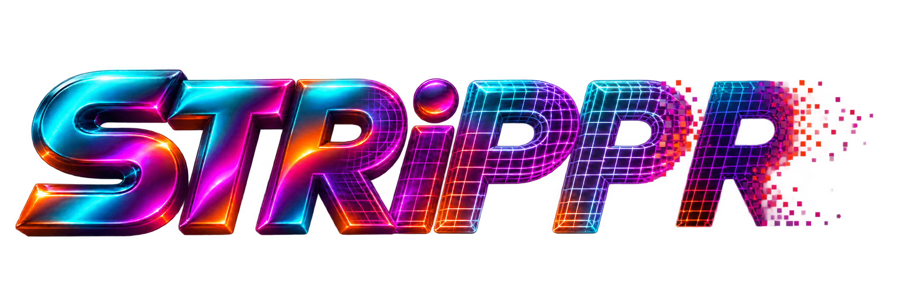

# STRiPPR



A lightweight native macOS app that removes supported descriptive video tags
without re-encoding or remuxing. No thumbnails, network service, FFmpeg, or
ExifTool at runtime.

> **LaZ's disclaimer:** My ChatGPT dot named **Dumdum** made this. I don't know
> how it works. You're welcome to download it, inspect it, change it, and run it
> **at your own risk**. No guarantees, no warranty. Back up anything you care about.

Copyright © 2026 **Merit Advertising Corp.** and STRiPPR contributors.
STRiPPR is MIT licensed. Cleaned copies are the default. Replacing originals is
optional and requires an explicit confirmation; it is not a backup system or a
complete metadata/privacy scrubber. See [LICENSE](LICENSE) and [NOTICE.md](NOTICE.md).

## Download and install

The [Releases page](https://github.com/meritadvertising/STRiPPR/releases) contains
an actual **Apple silicon (arm64) app ZIP**, separately from GitHub's source-code
archives. Download `STRiPPR-1.3.1-macOS-arm64.zip`, unzip it, and move `STRiPPR.app`
to Applications if desired. `SHA256SUMS.txt` is provided alongside it:

```sh
shasum -a 256 STRiPPR-1.3.1-macOS-arm64.zip
```

**The app is ad hoc signed, not Developer ID signed or notarized by Apple.**
macOS may block it. Review the source and the checksum before deciding whether
you trust it. Apple's [opening downloaded apps guide](https://support.apple.com/en-us/102445)
explains the per-app Privacy & Security approval. No global security changes are
required by STRiPPR. Approval is your decision.

The build targets **macOS 14 or later** and was tested on macOS 27 with Apple
silicon. Older supported macOS versions and Intel hardware have not been tested.
There is no Windows/Linux app or Intel binary in this release.

## Use

1. Drop video files or folders into the window, or use **Add Files or Folders**
   (Command-O). Subfolders are searched recursively. Hidden files, packages,
   symlinks, duplicates, and existing `.stripped` copies are skipped.
2. Use **Both** (the default), **With tags**, or **Without tags**. These refer to
   safely removable fields under the current encoder setting. Unsupported,
   unscanned, and uncertain inventories appear in Both. Sort by name, removable
   tag count, size, or status; the arrow reverses the order.
3. Expand a row to inspect removable/retained tags and limitations. Filtering
   changes the view; **Strip processes all ready files in the queue**, including
   hidden rows. The ready-file count is shown above the list.
4. **Keep originals** and **Keep encoder info** start checked. The save destination
   and adjacent **Choose folder** button share one line with these switches.
   Turning encoder retention off rescans the queue. Turning original retention
   off selects replacement mode; the confirmation states the batch scope,
   affected paths, and lack of an automatic backup.
5. Click **Strip supported tags** (Shift-Command-S). Progress appears above the
   list and on active files. Cancel with the button or Command-period.

On volumes with hard links, copy names are `name.stripped.ext`, then
`name.stripped-1.ext`, and so on. On volumes without the required atomic file
operations, a verified cleaned copy is published inside a new uniquely named
output folder. Existing copy outputs are never overwritten. A requested replacement
on such a volume also keeps the original and reports that fallback explicitly.
Clear empties the queue without deleting saved files. Failed/cancelled entries can
be rescanned. Both keep switches reset
to their safe defaults on launch.

## Formats and limits

| Container | Current behavior |
| --- | --- |
| MP4 / M4V / MOV and related ISO/QuickTime containers | Removes allowlisted descriptive `ilst`, `mdta`, and movie/track user-data fields, including supported title, artist, album, comments, dates, credits, catalog/sort fields, lyrics, copyright, and locations. |
| AVI | Removes allowlisted descriptive fields in top-level RIFF `INFO` lists. |
| MPG / MPEG program streams and recognized transport streams | Read only: identifies the container. Embedded tags are **not inventoried or removed**. |
| MKV / Matroska / WebM | Read only: identifies the container. Embedded tags are **not inventoried or removed**. |
| Unknown or invalid structures | Explicitly unsupported or failed; no cleaned result is published. |

Unknown metadata stays. Known container encoder/software fields stay by default;
turning retention off removes only the supported container fields. Encoder
identifiers inside compressed packets, codec configuration, delay/padding,
normalization, language, orientation, timing, color/HDR, chapters, DRM identity,
and other playback structures remain. Artwork stays because readers may expose
it as an attached-picture stream. No tracks are silently dropped.

Inventory is limited to recognized structures. STRiPPR does not inspect every
proprietary field or compressed-stream tag, scrub filenames/filesystem history,
sidecars/backups, or certify that a file contains no metadata. See
[the metadata coverage document](docs/METADATA-SUPPORT.md) and the scanner's
explicit allowlists.

## How files are protected

Only approved metadata ranges change. Equal-length padding preserves file
length, media offsets, and all bytes outside those ranges. Before publishing,
STRiPPR compares the entire staged result against the source plus intended edits,
checks file identity/change times, and rescans under the same encoder policy.

On supported local volumes, copies use exclusive hard-link publication and
replacement uses a guarded atomic swap. If a volume reports those file operations
as unsupported and permits ordinary directory rename, STRiPPR keeps the original
and publishes the verified file by renaming its
nonempty staging directory to a fresh output-folder name. This is a kept-copy
fallback, not an in-place NAS replacement. It does not use delete-then-rename.

Filesystem metadata is checked before the large copy, reapplied after all data
writers close, and independently verified before publication. Quarantine, access-control lists,
ownership, permissions, flags, modification time, and unrelated attributes must
pass those checks. Only a refused copy of `com.apple.provenance` can be omitted,
with an explicit warning that system security tracking information was not
preserved. STRiPPR does not clear source attributes, interpret quarantine flags,
force denied writes, or change OS security settings. OS-added provenance is kept
and reported. A result with warnings is marked in amber even with its row closed.

Replacement rejects symlinks, shared hard links, locked/read-only files, and
unsupported ownership/permissions. Copying also fails if required filesystem
metadata cannot be preserved or verified. Concurrent changes fail safely and
may require rescanning.

Cancellation before commit preserves the original; an already committed
replacement finishes and is reported. Uncertain swap/rollback or cleanup failures
show any recovery path. Normal failures clean up unfinished staging. Forced
termination or power loss can leave a hidden `.strippr-UUID` staging folder. This is not a
crash-durability guarantee. Test on disposable copies and keep your own backups.

## Build from source

Requires macOS, a **Swift 6 toolchain** (Xcode or Command Line Tools), and Git.
Quit STRiPPR before rebuilding its local app bundle.

```sh
git clone https://github.com/meritadvertising/STRiPPR.git
cd STRiPPR
./script/build_and_run.sh --build-only
open dist/STRiPPR.app
```

The bundle is signed locally for that build; this does not produce Developer ID
signing or notarization. Building from source does not download runtime packages.
The package also builds `.build/debug/strippr-cli` for scanning/cleaning from the
command line. Replacement requires both `--replace-original` and
`--confirm-replacement` flags; run it without arguments to see the supported options.

## Tests and release packaging

The XCTest safety suite uses synthetic fixtures, including 500-file filter/sort and
responsiveness tests; they do not require private media or FFmpeg:

```sh
./Tests/run.sh
```

Full Xcode provides XCTest; the runner selects it for that command without
changing the machine's global selection. Optional integration checks need
Python 3 and separately installed FFmpeg/FFprobe (including libx264/libx265):

```sh
python3 script/generate_test_fixtures.py
python3 script/verify_media_fixtures.py
python3 script/verify_cleaning_options.py
```

Set `FFMPEG` / `FFPROBE` to override PATH discovery. These tools are test-only and
are not bundled. The optional VLC regression tool requires a separately installed
VLC. No user sample media, screenshots, private logs, local agent utilities, or
build artifacts are included in the source repository.

The app was exercised with a 500-file GUI batch: eight tagged files were cleaned,
all 500 source hashes stayed unchanged, and the outputs passed independent stream,
packet-payload, and decoded-output checks. Tests also cover rotation, HDR10,
multiple audio/subtitle streams, artwork retention, cancellation, corrupt input,
collisions, source changes, replacement guards, and stale confirmations. The
physical Finder drag gesture was confirmed by LaZ. These checks are evidence,
not a promise that every file or system is safe.

`script/package_release.sh` creates an optimized arm64 ZIP and checksums using
Swift, Python 3, and macOS tools. It strips debug information, remaps build paths,
and omits filesystem xattrs/resource forks from the package. It does **not**
notarize the app.

## Credits

Created for **LaZ / Merit Advertising Corp.** with his ChatGPT dot, **Dumdum**.
Dumdum generated and implemented the app under LaZ's direction. The credits
describe AI assistance and do not claim exclusive human authorship of AI-generated
material. The copyright notice and MIT permissions coexist; see [NOTICE.md](NOTICE.md).
